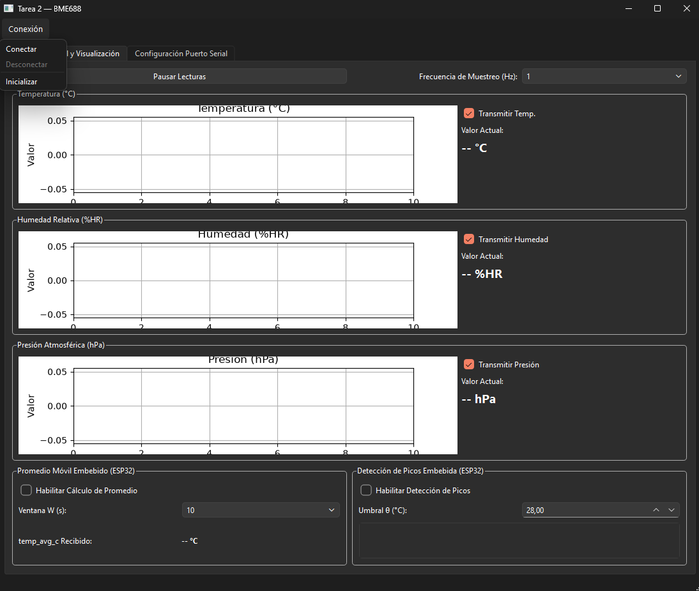
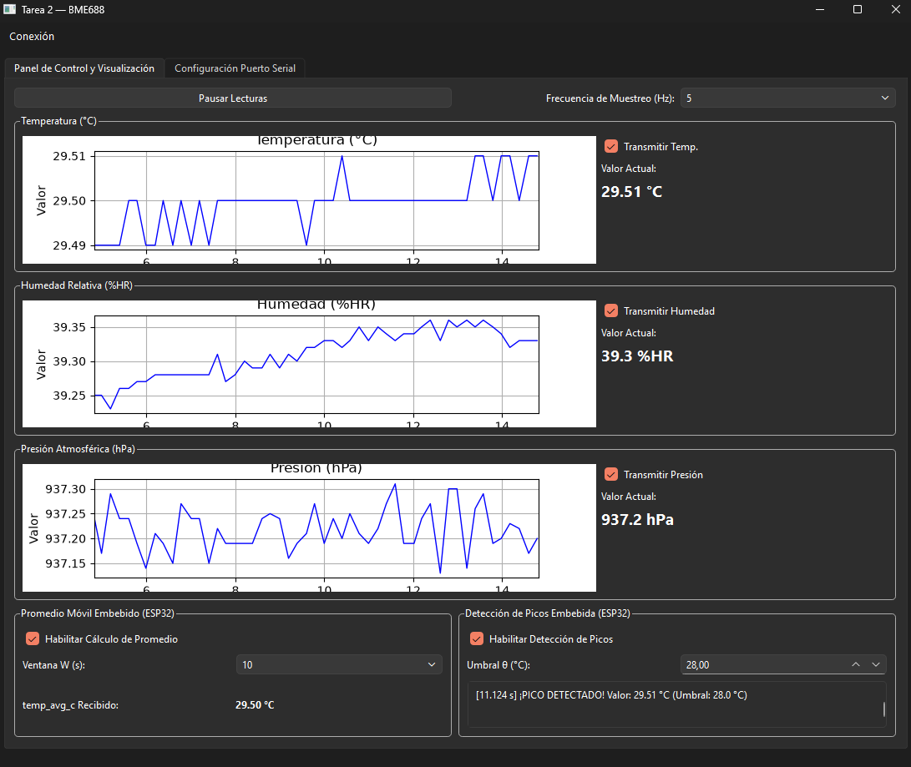
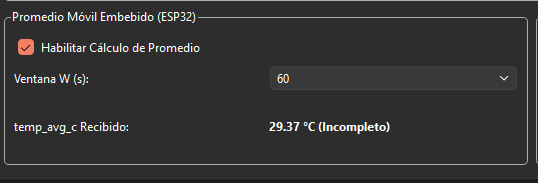
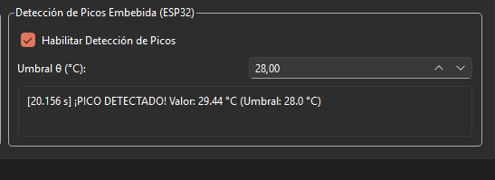
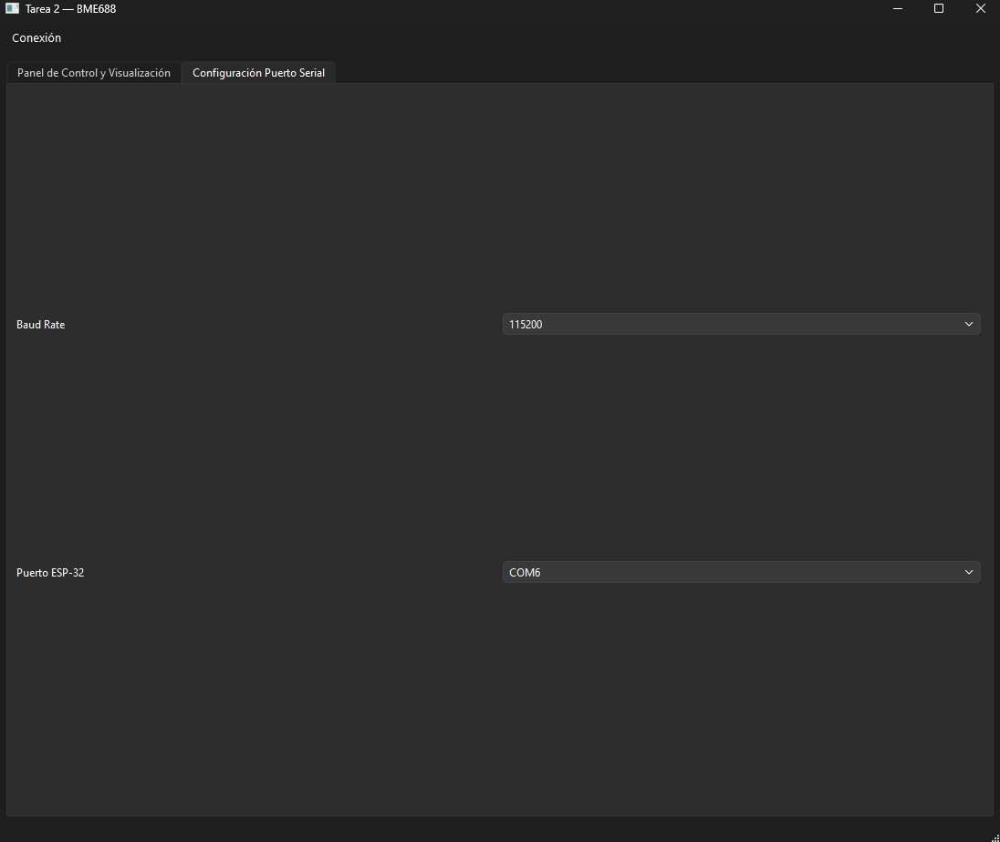

# CC5328 — Tarea 2 (ESP32 + BME688 + PyQt6)

**Integrantes:**
- Julio Yáñez
- Ulises Faúndez


## 1. Descripción General

Este proyecto implementa las lecturas de un MBE688, procesamiento de promedios y picos en un ESP32, junto con la creación de una interfaz gráfica en PyQt6 para su visualización

## 2. Instalación
### 2.1. Firmware ESP32

1. Abrir una terminal con el entorno de ESP-IDF cargado (export.sh en Linux o ESP-IDF PowerShell/CMD en Windows).
2. Navegar al directorio del firmware:
   ```bash
   cd esp32_firmware
   ```
3. Compilar y flashear la placa conectada por USB:
   ```bash
   idf.py build flash
   ```

### 2.2. GUI

1. Navegar al directorio de la interfaz gráfica:
   ```bash
   cd gui_python
   ```
2. Crear y activar un entorno virtual:
   ```bash
   python -m venv venv
   # En Windows (PowerShell):
   ./venv/Scripts/activate
   # En Linux / macOS:
   source venv/bin/activate
   ```
3. Instalar los requirements:
   ```bash
   pip install -r requirements.txt
   ```
4. Iniciar la gui
   ```bash
   python3 main.py
   ```


## 3. Conexión Física y Pines

El sensor BME688 se comunica con el ESP32 mediante I2C a 400kHz. La comunicación con el PC se realiza mediante UART0 por USB

| Pin BME688 | Pin ESP32 | Función
| :--- | :--- | :---
| **VCC** | **3V3**     | Alimentación
| **GND** | **GND**     | Tierra
| **SCL** | **GPIO 32** | I2C Clock 
| **SDA** | **GPIO 33** | I2C Data 
| **SDO** | **GND**     | Dirección 0x76


## 4. Uso
Teniendo el ESP32 conectado por usb, abrimos la GUI. En la pestaña de Conexión aparece la opción para conectarse al ESP32. Una vez hecho eso, se activarán los gráficos de Temperatura, Humedad y Presión




En la parte inferior, están las opciones para habilitar la detección de promedios y de picos respectivamente.




En la pestaña de Configuración Puerto Serial, se puede cambiar el baud rate, o el puerto (por si tienes dos esp32 lol)




## 5. Formato del Protocolo Serial

Todas las transmisiones son líneas ASCII terminadas en \n con verificación de integridad mediante un **checksum XOR** de 2 dígitos hexadecimales en mayúsculas precedido por *:

```text
<CUERPO>*<CK>\n
```

Donde `<CK>` corresponde al XOR byte a byte de todos los caracteres de `<CUERPO>` (sin incluir * ni \n). Cualquier linea con formato inválido, longitud excesiva o checksum incorrecto se descarta silenciosamente.

## 6. Comandos

### 6.1. Comandos (PC $\rightarrow$ ESP32)

| Comando   | Ejemplo   | Descripción  |
| :---      | :---               | :---         |
| `FRECUENCIA,<dhz>` | `INICIAR*4B\n` | Comando inicial. Hace un reinicio de las configuraciones y empieza a medir el tiempo de conexión. |
| `FRECUENCIA,<dhz>` | `FRECUENCIA,10*4B\n` | Fija la frecuencia de muestreo en deciHercios (10dHz -> 1Hz). Solo son permitidos $Hz \in \{0.5, 1, 2, 5\}$|
| `METRICAS,<mask>` | `METRICAS,6*52\n` | Habilita o deshabilita la transmisión de Temperatura, Humedad y Presión, mediante una mascara. Por ejemplo, 6 -> 0b110 -> Solo medir temperatura y humedad. |
| `PROMEDIO,<en>,<W>` | `AVG,1,30*7E\n` | Activa/desactiva la el cálculo de promedio en el esp32 y fija la ventana temporal $W \in \{5, 10, 30, 60\}\text{ s}$. |
| `PICOS,<en>,<umbral>` | `PEAK,1,27.2*61\n` | Activa/desactiva la detección de picos y fija el umbral $\theta$ en $^\circ\text{C}$. La diferencia entre temperaturas debe superar los 0.01 para apreciarse y ser considerado pico. |
| `BAUDIOS,<valor>` | `BAUDIOS,230400*17\n` | Establece la velocidad en baudios de la transmisión |

### 6.2. Respuestas (ESP32 $\rightarrow$ PC)

| Comando | Ejemplo | Descripción |
| :---    | :---        | :---    |
| `OK,<CMD>,<DETALLE>*CK\n` | `OK,FREQ,10*3A\n` | Si el comando se ejecutó correctamente |
| `ERROR,<CMD>,<MOTIVO>*CK\n` | `ERROR,METRICAS,formato invalido*1C\n` | Si hubo un error al ejecutar el comando, o si el comando se desconoce. |

- **Paquete unificado de telemetría:**
  Se envía un único paquete etiquetado `CLAVE:VALOR` por ciclo de muestreo, incluyendo únicamente las métricas habilitadas y el evento de pico si ocurrió en ese instante:
  ```text
  DATO,SEQ:34,TEMP:29.91,HUM:37.68,PRES:937.26,TEMP_AVG_C:29.90,TEMP_AVG_OK:1*4F\n
  ```
  Cuando se detecta un máximo local válido, se adjuntan en el paquete los campos del evento:
  ```text
  DATO,SEQ:35,TEMP:29.88,HUM:37.70,PRES:937.17,PICO:29.91,UMBRAL:28.0,PICO_T:29475*62\n
  ```

---

## 7. Estructura

```text
CC5328-Tarea-2/
├── esp32_firmware/          # Firmware del esp32
│   ├── CMakeLists.txt
│   └── main/
│       ├── CMakeLists.txt
│       ├── main.c           # Inicialización de los módulos e inicio de tasks
│       ├── bme688.c / .h    # Inicialización del bme688, funciones de calibración y bme_get_measurements()
│       ├── tasks.c / .h     # Define las tareas a ejecutar. La escucha del puerto usb, como la obtención de datos
│       ├── protocol.c / .h  # Serialización de la información y funciones de envío
│       └── comandos.c / .h  # Parser de comandos entrantes y respuestas OK/ERROR
├── gui_python/              # GUI
│   ├── main.py              # Ventana principal, control de estado y gráficos
│   ├── receptor.py          # Hilo QThread para lectura UART
│   ├── protocol.py          # Protocolo para enviar señales al esp32
│   ├── live_plot.py         # Widget de graficación en tiempo real
│   ├── bme688_gui.ui / .py  # Interfaz gráfica diseñada en Qt Designer
│   └── requirements.txt     # Dependencias de Python
└── README.md
```

### Decisiones de diseño importantes
1. **Separación de tareas de recepción y adquisición**
   Un hilo independiente para la recepción de comando y para la adquisición de las lecturas del BME688. Esto implico utilizar mutex para cambiar la configuración global del esp32. Todas esas funciones están dentro de tasks.c

2. **Criterio del promedio y detección de picos:**
   - **Promedio:** Utiliza una lista de largo 300, suficiente para almacenar los samples de $W=60s" con $5Hz$ de frecuencia. Se hubiese podido ir almacenando una suma, pero hubiese requerido volver a recalcular todo el promedio al cambiar el W. Sin embargo, al modificar la frecuencia, se empieza desde cero, ya que varian los samples por segundo.
   - **Detección de picos:** Además de las tres condiciones de borde, la diferencia entre temperaturas debe superar las centesimas para tomarse en cuenta. Luego, $T = 28.858$ y $T = 28.857$ no se considera distintos para efectos de un pico.


## 8. Video Demostrativo

- **Enlace al video de demostración:** [Agregar enlace de YouTube / Google Drive aquí](https://tu-enlace-al-video.com)